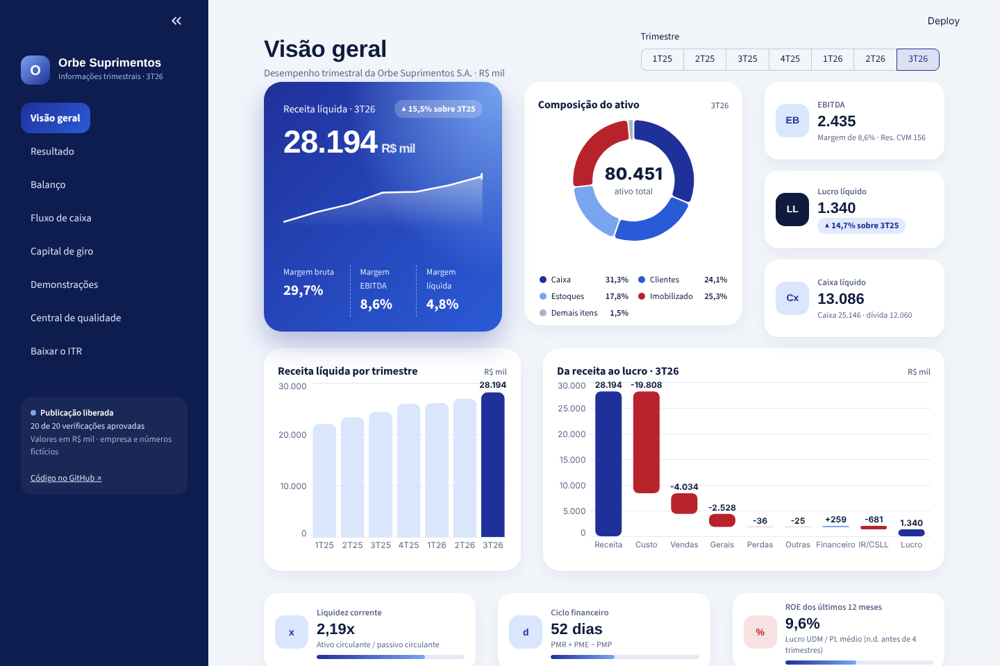
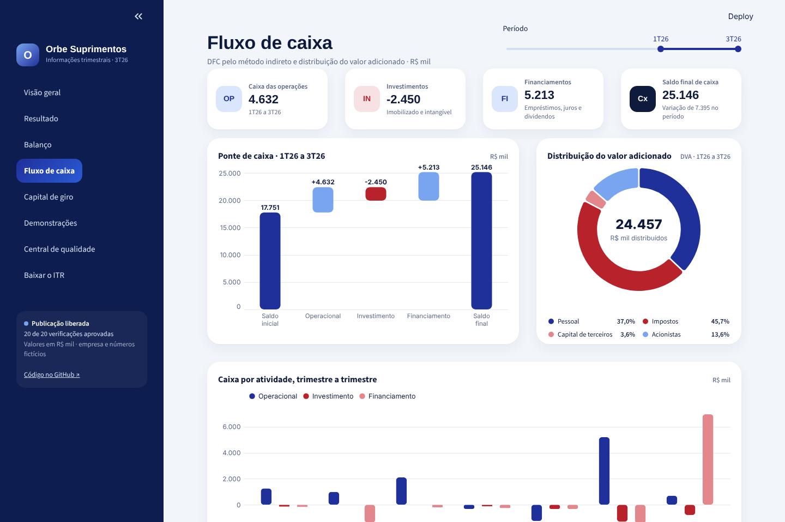
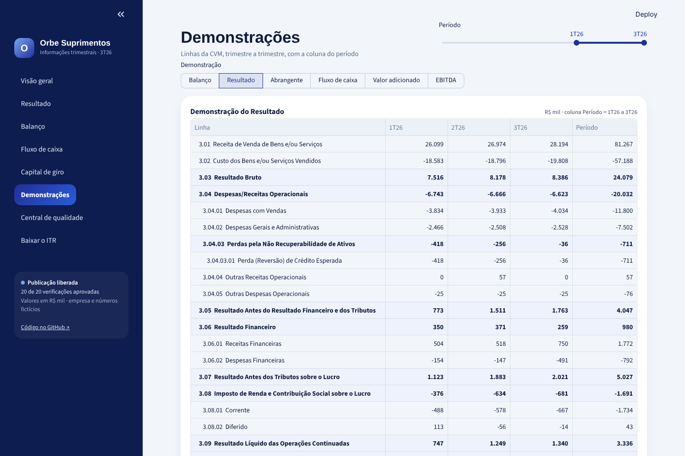
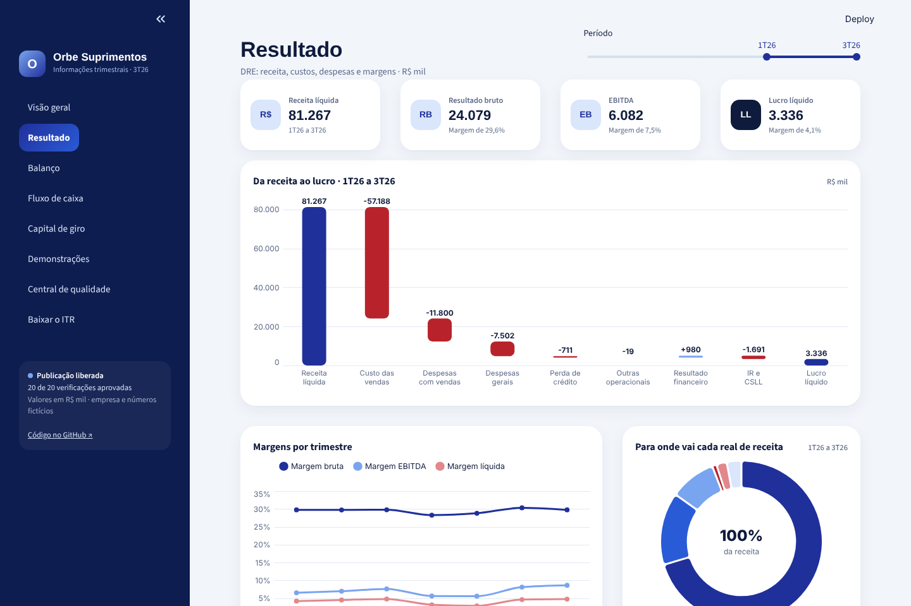
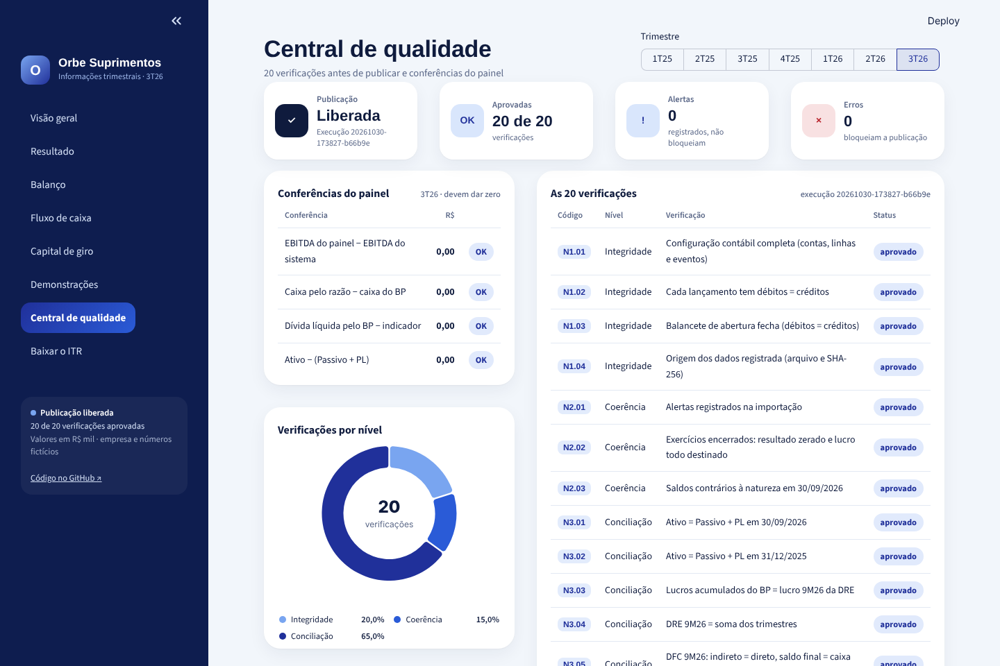

# Sistema ITR

Sistema de fechamento trimestral que recebe a contabilidade de uma companhia aberta e entrega as
Informações Trimestrais (ITR): as sete demonstrações, notas explicativas, comentário de desempenho e
indicadores, em Excel, PDF e um painel web. Antes de qualquer arquivo sair, uma central
de qualidade confere 20 pontos, e um erro bloqueia a publicação.

A empresa é fictícia: **Orbe Suprimentos S.A.**, distribuidora B2B de suprimentos empresariais,
S.A. aberta, Lucro Real trimestral. O ITR principal é o do **3º trimestre de 2026**.

**Ver o resultado sem instalar nada:**
[ITR em PDF](exemplos/ITR_Orbe_3T26.pdf) ·
[ITR em Excel](exemplos/ITR_Orbe_3T26.xlsx) ·
[painel web](https://sistema-itr.streamlit.app)



> Projeto acadêmico. A estrutura segue o formulário ITR da CVM, mas nada aqui é um ITR real: o ITR
> oficial é enviado pelo Empresas.NET e passa por revisão de auditor independente.

## O 3T26 da Orbe em números

| | 3T26 | 3T25 | Variação |
| --- | ---: | ---: | ---: |
| Receita líquida (R$ mil) | 28.194 | 24.418 | +15,5% |
| EBITDA (R$ mil) | 2.435 | 1.859 | +31,0% |
| Margem EBITDA | 8,6% | 7,6% | +1,0 p.p. |
| Lucro líquido (R$ mil) | 1.340 | 1.168 | +14,7% |

No 3T26 a Orbe captou uma CCB de R$ 8 milhões para capital de giro e ampliou o galpão. Mesmo assim,
terminou setembro com caixa líquido de R$ 13 milhões (mais caixa do que dívida).

## Como funciona

```
Excel de entrada ─► validação ─► base SQLite ─► motor contábil ─► Central de qualidade ─┬─► ITR em Excel e PDF
(lançamentos,      (débito =     (razão,        (BP, DRE, DRA,     (20 verificações;     ├─► Parquet ─► painel web (Streamlit)
 abertura,          crédito,      cadastros)     DFC, DMPL, DVA,    erro bloqueia)        └─► Parquet ─► modelo para Power BI
 cadastros)         contas,                      notas,
                    datas)                       indicadores)
```

Os lançamentos chegam por um Excel com contrato definido (colunas, tipos, contas válidas). Para a
Orbe, esse Excel é gerado a partir de um roteiro de negócios de 21 meses (`config/roteiro.yaml`):
vendas, compras, folha, impostos, empréstimos, investimentos e dividendos viram 2.964 partidas
dobradas. O motor parte só do razão e do plano de contas. Nenhum número das demonstrações é digitado.

## O que tem de contabilidade

| Tema | Norma | Como aparece no sistema |
| --- | --- | --- |
| Períodos do ITR | CPC 21 | BP contra 31/12 do ano anterior; DRE do trimestre e acumulada contra o mesmo período do ano anterior |
| Fluxo de caixa | CPC 03 | Método indireto, conferido pelo método direto; transações sem caixa divulgadas à parte |
| Valor adicionado | CPC 09 | Tributos recuperáveis incluídos nos insumos e distribuição de tributos pelo líquido |
| Tributos sobre o lucro | CPC 32 | IRPJ e CSLL correntes e diferidos sobre perda esperada e provisão de estoques, com reconciliação da alíquota |
| Perda esperada | CPC 48 | Constituição e reversão por trimestre, com linha própria na DRE |
| Estoques | CPC 16 | Custo médio ponderado móvel e provisão para perdas |
| Imobilizado | CPC 27 | Depreciação por bem, baixas com ganho ou perda |
| Lucro por ação | CPC 41 | Média ponderada de ações no período |
| Patrimônio líquido | Lei 6.404/76 | Reserva legal, dividendo mínimo obrigatório e DMPL coluna a coluna |
| EBITDA | Res. CVM 156 | Reconciliação a partir do lucro líquido |

As políticas contábeis e as simplificações estão em `docs/01_empresa_e_politicas.md`.

## Controles

- **Central de qualidade** (`src/qualidade.py`): 20 verificações em três níveis. Integridade: cada
  lançamento fecha e a origem do arquivo é registrada com SHA-256. Coerência: exercícios encerrados e
  saldos contrários à natureza. Conciliação: Ativo = Passivo + PL, DFC indireta = direta, DMPL = PL do
  BP, notas = demonstrações, EBITDA pelos dois caminhos. Erro bloqueia; alerta fica registrado. Cada
  execução fica gravada com data, hora e resultado.
- **Conferências por fórmula** no Excel e **conferências na tela** no painel web. Todas devem dar
  zero.
- **255 testes automáticos** (`pytest`), incluindo testes de mutação: regras quebradas de propósito
  para confirmar que os testes acusam.

## O painel

O Python exporta um modelo estrela em Parquet (5 dimensões, 4 fatos). O painel web, em Streamlit
(`app/painel.py`), lê esses arquivos e só agrega: não recalcula a contabilidade. Cada linha das
demonstrações diz como deve ser agregada no tempo. Fluxos somam os trimestres. Saldos de balanço
ficam com o último trimestre: é a regra semiaditiva, conferida pelos testes contra o 9M26 do ITR.

| | |
| --- | --- |
|  |  |
|  |  |

O painel tem oito páginas: visão geral, resultado (cascata da receita ao lucro e margens), balanço
(composição do ativo e estrutura de capital), fluxo de caixa (ponte de caixa e DVA), capital de giro
(prazos médios e ciclo financeiro), demonstrações linha a linha, Central de qualidade e download do ITR.

O mesmo modelo está pronto para o Power BI: as consultas Power Query e as medidas DAX, comentadas,
ficam em `powerbi/`, e o roteiro para montar o painel está em `docs/11_power_bi.md`. O arquivo .pbix
não faz parte do repositório.

## Como rodar (Windows)

Pré-requisitos e instalação passo a passo: `docs/00_guia_instalacao_windows.md`.

```powershell
python -m venv .venv
.venv\Scripts\Activate.ps1
pip install -r requirements.txt
python -m playwright install chromium   # uma vez: navegador que imprime o PDF

python src/gerar_dados.py               # contabilidade da Orbe: entrada/entrada_itr.xlsx
python src/importar_entrada.py          # valida e grava base/itr.sqlite
python src/qualidade.py                 # Central de qualidade
python src/gerar_itr.py                 # ITR em saidas/3T26/ (Excel, PDF e HTML)
python src/exportar_parquet.py          # Parquet para o painel web e o Power BI
streamlit run app/painel.py             # painel web em http://localhost:8501
pytest                                  # testes
```

Para consultar uma demonstração no terminal: `python src/demonstracoes.py` (BP e DRE),
`python src/dfc_dmpl.py`, `python src/dra_dva.py`, `python src/notas.py`, `python src/indicadores.py`.
Todos aceitam outro trimestre, por exemplo `python src/demonstracoes.py 2T26`.

## Estrutura

```
sistema-itr/
├── config/       empresa, plano de contas, linhas da CVM, eventos e mapeamentos (.csv e .yaml)
├── entrada/      Excel de entrada (modelo em branco e o da Orbe)
├── src/          código Python: validação, motor contábil, Central, exportadores
├── modelos/      modelo HTML/CSS do PDF
├── app/          painel web (Streamlit)
├── powerbi/      consultas Power Query e medidas DAX para montar o painel no Power BI
├── exemplos/     ITR do 3T26 em PDF e Excel, e a exportação Parquet usada pelo painel web
├── testes/       testes automáticos
├── docs/         uma explicação por etapa, com decisões, regras e limitações
├── base/         itr.sqlite (gerado, fora do Git)
├── saidas/       ITRs gerados (fora do Git)
└── exportacao/   Parquet gerado (fora do Git)
```

## Documentação

| Documento | Assunto |
| --- | --- |
| `docs/00_guia_instalacao_windows.md` | Preparar o computador |
| `docs/01_empresa_e_politicas.md` | A empresa, as políticas contábeis e as simplificações |
| `docs/02_plano_de_contas_e_regras.md` | Plano de contas e como cada demonstração é montada |
| `docs/03_contrato_de_entrada.md` | Formato do Excel de entrada, validações e tabelas da base |
| `docs/04_gerador_de_dados.md` | Como o roteiro vira lançamentos e a história da Orbe |
| `docs/05_bp_e_dre.md` | BP, DRE, períodos do CPC 21 e lucro por ação |
| `docs/06_dfc_e_dmpl.md` | DFC indireta conferida pela direta e DMPL por coluna |
| `docs/07_dra_dva_e_notas.md` | DRA, DVA com o ajuste do CPC 09 e as 10 notas explicativas |
| `docs/08_indicadores.md` | Fórmulas dos indicadores e reconciliação do EBITDA |
| `docs/09_central_de_qualidade.md` | As 20 verificações e o registro de cada execução |
| `docs/10_excel_e_pdf.md` | O ITR em Excel e PDF e o comentário de desempenho |
| `docs/11_power_bi.md` | Modelo estrela, medidas semiaditivas em DAX e roteiro para montar o Power BI |
| `docs/12_painel_web.md` | Painel em Streamlit e como publicá-lo |

## Limitações

- Demonstrações individuais de uma única empresa: sem controladas, segmentos, moeda estrangeira ou
  arrendamentos no escopo do CPC 06.
- 10 notas explicativas selecionadas, não o conjunto completo.
- O comentário de desempenho é escrito por regras a partir dos números; não substitui a análise da
  administração.
- Sem revisão de auditor e sem envio à CVM.

## Autor

Robert Sousa Paiva, contador (UERJ, CRC ativo).
[LinkedIn](https://www.linkedin.com/in/robertsousapaiva) · [GitHub](https://github.com/robsousax)

Ferramentas: Python (pandas, openpyxl, SQLite, pytest), Jinja2 e Playwright para o PDF, Streamlit e
Altair para o painel web, Parquet com consultas Power Query e medidas DAX para o Power BI.
